# Лабораторная работа №3. Маршрутизация, параметры пути и query-параметры

**Ванян Давид, ПИЖ-б-о-25-2(1)**

**Вариант:** 8 (Сотрудники / employees)

**Технология:** Node.js + Express

## Цель работы
Освоить различные способы передачи данных через URL. Научиться строить гибкие маршруты с параметрами пути и query-параметрами, комбинировать их, обрабатывать вложенные ресурсы и валидировать входные данные. Понять разницу между req.params, req.query и req.body.

## Теоретическое обоснование
Маршрутизация — это механизм сопоставления HTTP-запроса (метод + URL) с кодом-обработчиком на сервере. В Express маршрут описывается как `app.METHOD(PATH, HANDLER)`. Данные передаются тремя способами: параметры пути (`req.params` — часть URL), query-параметры (`req.query` — после знака `?`, используются для фильтрации и сортировки), и тело запроса (`req.body` — для POST/PUT). Вложенные маршруты отражают иерархию ресурсов, а wildcard-маршруты используются для обработки ошибки 404.

## Выполнение практического примера

Для начала изменим package.json и подключим наш сервер
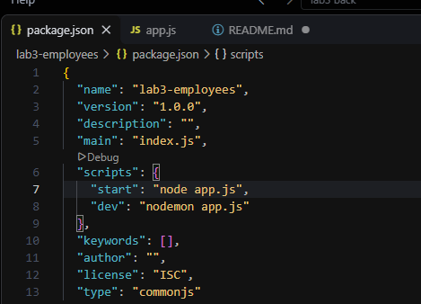
Сервер реализован на **Node.js + Express**. Данные хранятся в массиве `employees` в оперативной памяти. Код покрывает все три уровня задания:

*   **Базовый уровень:** Реализованы маршруты `/employees` (все записи) и `/employees/:id` (одна запись). Добавлена валидация ID (если переданы буквы — возвращается ошибка **400**, если записи нет — **404**). Также добавлены вложенные маршруты (`/employees/:id/tasks`) и фильтр по отделу (`/departments/:dept/employees`).
*   **Средний уровень:** Эндпоинт `/employees/search` принимает query-параметры: `search` (поиск по имени), `filter_dept` и `filter_salary` (фильтрация), `sort` и `order` (сортировка по белому списку полей), `page` и `limit` (пагинация с валидацией значений).
**Важный нюанс:** В коде маршруты `/employees/stats` и `/employees/search` специально объявлены *выше* маршрута `/employees/:id`. Это предотвращает конфликт, при котором Express мог бы воспринять слова "stats" или "search" как ID сотрудника.

**Скриншоты запросов (Базовые и Средние):**
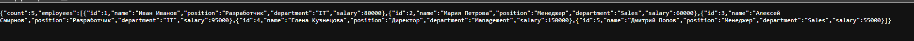
**Рисунок 1 – Получение списка всех сотрудников (GET /employees)**

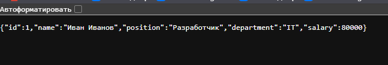
**Рисунок 2 – Получение сотрудника по ID (GET /employees/1)**

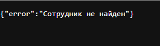
**Рисунок 3 – Обработка ошибки 404 (сотрудник не найден)**

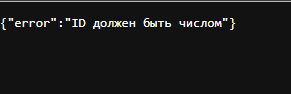
**Рисунок 4 – Обработка ошибки 400 (нечисловой ID)**

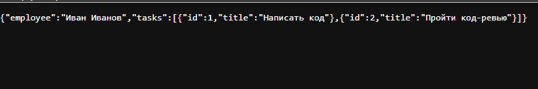
**Рисунок 5 – Вложенный ресурс: задачи сотрудника (GET /employees/1/tasks)**

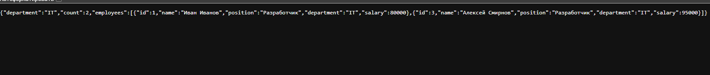
**Рисунок 6 – Сотрудники отдела IT (GET /departments/IT/employees)**

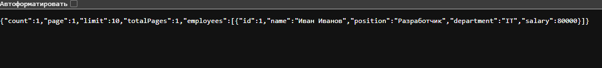
**Рисунок 7 – Поиск сотрудника по имени (?search=Иван)**

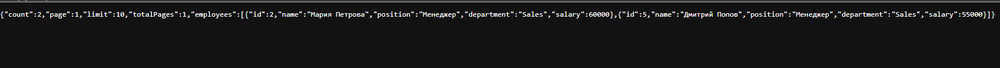
**Рисунок 8 – Фильтрация по отделу (?filter_dept=Sales)**

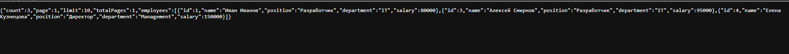
**Рисунок 9 – Фильтрация по зарплате (от 70000)**

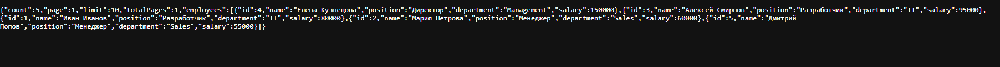
**Рисунок 10 – Сортировка по убыванию зарплаты**

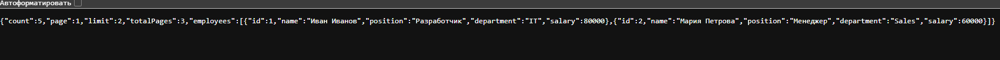
**Рисунок 11 – Пагинация (страница 1, по 2 записи)**

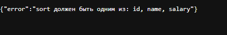
**Рисунок 12 – Обработка ошибки 400 (недопустимое поле сортировки)**

## Выполнение индивидуального задания
В ходе выполнения были реализованы все 3 уровня для сущности "Сотрудники".
Статистика включает в себя подсчет средней зарплаты по всей компании и по каждому отделу.

**Скриншоты продвинутого уровня:**
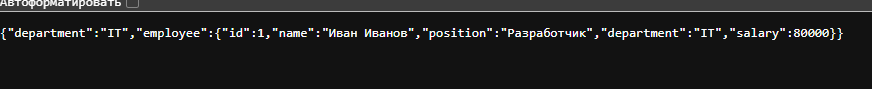
**Рисунок 13 – Множественные параметры пути (отдел + ID)**

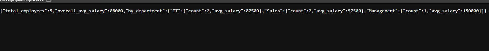
**Рисунок 14 – Статистика: средняя зарплата по компании и отделам**

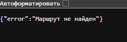
**Рисунок 15 – Обработка ошибки 404 (wildcard-маршрут)**

## Ответы на контрольные вопросы

### Базовый уровень

**1. Что такое маршрутизация? Как она работает в Express/Flask?**
Маршрутизация — это механизм сопоставления HTTP-запроса (метод + URL) с конкретным кодом-обработчиком на сервере. 
*   В **Express** маршрут задается методом приложения: `app.get('/path', handler)`.
*   В **Flask** маршрут задается с помощью декоратора: `@app.route('/path', methods=['GET'])`.

**2. Чем отличаются req.params, req.query и req.body?**
*   `req.params` — параметры пути, являются частью URL (например, `id` в `/users/42`). Используются для идентификации ресурса.
*   `req.query` — query-параметры, идут после знака `?` (например, `?age=20`). Используются для фильтрации, сортировки, поиска.
*   `req.body` — данные, передаваемые в теле запроса (обычно в формате JSON при POST/PUT/PATCH). Используются для создания или обновления данных.

**3. Как получить параметр пути в Express? Во Flask?**
*   **Express:** Параметр объявляется в пути через двоеточие (`/users/:id`), а получается из объекта `req.params.id`.
*   **Flask:** Параметр объявляется в угловых скобках (`/users/<int:user_id>`), а получается как аргумент функции-обработчика `def get_user(user_id):`.

**4. Что произойдёт, если не преобразовать параметр пути в число?**
В Express все параметры пути по умолчанию приходят в виде строк. Если не использовать `parseInt(req.params.id)`, то при строгом сравнении (`===`) с числами в базе данных возникнет ошибка, и ресурс не будет найден.

**5. Как обработать ситуацию, когда параметр пути отсутствует?**
Если маршрут не совпадает с запрошенным URL, срабатывает обработчик 404. Если параметр должен быть необязательным, в Express используют знак вопроса: `/users/:id?`, а во Flask задают значения по умолчанию через `defaults`.

**6. Что такое вложенные маршруты? Приведите пример.**
Это маршруты, отражающие иерархическую связь между ресурсами (родитель-ребенок). Пример: `GET /employees/1/tasks` — получить список задач для сотрудника с ID 1.

**7. Какой код ответа возвращается, если ресурс не найден?**
`404 Not Found`.

**8. Какой код ответа возвращается при невалидном параметре?**
`400 Bad Request`.

**9. Как объявить необязательный параметр пути в Express?**
С помощью вопросительного знака после имени параметра: `/users/:id?`.

**10. Как работает порядок объявления маршрутов в Express? Почему он важен?**
Express проверяет маршруты строго сверху вниз. Это важно, потому что если сначала объявить общий маршрут (например, `/employees/:id`), он перехватит запросы к специфичным маршрутам (например, `/employees/stats`), восприняв слово "stats" как ID. Поэтому специфичные маршруты всегда пишутся выше.

---

### Средний уровень

**11. Как получить query-параметры в Express/Flask? Чем они отличаются от параметров пути?**
*   **Express:** `req.query`.
*   **Flask:** `request.args.get('name')`.
Параметры пути являются частью самого адреса ресурса (идентификатор), а query-параметры — это дополнительные настройки, идущие после `?` (фильтры, пагинация). 

**12. Как задать значение по умолчанию для query-параметра?**
*   **Express:** `const page = req.query.page || 1;`
*   **Flask:** `page = request.args.get('page', 1, type=int)`

**13. Как реализовать поиск по подстроке через query-параметр?**
Нужно получить query-параметр (например, `search`) и отфильтровать массив с помощью метода `.includes()` (в JS) или оператора `in` (в Python), приведя обе строки к нижнему регистру для независимости от регистра.

**14. Как реализовать сортировку по нескольким полям?**
Использовать метод `sort()` (в JS) с функцией сравнения, которая сначала сравнивает значения первого поля, а если они равны — переходит к сравнению второго поля.

**15. Как реализовать пагинацию с подсчётом общего количества страниц?**
Вычислить начальный индекс `start = (page - 1) * limit`. С помощью метода `slice(start, start + limit)` отрезать нужную часть массива. Общее количество страниц вычисляется как `Math.ceil(totalCount / limit)`.

**16. Как валидировать query-параметры? Какие коды ответов использовать?**
Проверять, входят ли значения в допустимый диапазон или белый список. Если параметр некорректен (например, `limit` больше 100), возвращать код `400 Bad Request` с описанием ошибки.

**17. Как реализовать фильтрацию по нескольким полям одновременно?**
Нужно последовательно применять методы `filter()` к массиву данных. Сначала фильтруем по одному параметру, затем результат фильтруем по второму и так далее.

**18. Что произойдёт, если query-параметр передан несколько раз (?tag=js&tag=node)?**
В Express объект `req.query.tag` превратится в массив `['js', 'node']`. Во Flask `request.args.getlist('tag')` также вернет список значений.

**19. Как ограничить максимальное значение limit?**
Считать значение из запроса, и если оно превышает заданный максимум (например, 100), либо возвращать ошибку `400`, либо принудительно устанавливать максимально допустимое значение.

**20. Как использовать белый список полей для сортировки?**
Создать массив разрешенных полей (например, `['id', 'name', 'salary']`). Перед сортировкой проверить, входит ли запрошенное поле в этот массив. Если нет — вернуть ошибку 400.

---

### Продвинутый уровень

**21. Как комбинировать параметры пути и query-параметры в одном запросе?**
Они просто используются вместе в URL. Например: `GET /users/42/posts?sort=date&limit=10`. В обработчике `id=42` берется из `req.params`, а `sort` и `limit` — из `req.query`.

**22. Как реализовать вложенные маршруты с несколькими уровнями?**
Указать в пути несколько параметров через слеши. Например: `app.get('/departments/:dept/employees/:empId', ...)`. Все они будут доступны в объекте `req.params`.

**23. Как обработать wildcard-маршрут и почему он должен быть последним?**
Wildcard-маршрут (`app.use('*')` или `app.use((req, res) => ...)`) перехватывает любые запросы. Он должен быть объявлен строго в самом конце файла, иначе он перехватит все запросы к другим маршрутам, объявленным ниже него.

**24. Как реализовать глобальный обработчик ошибок?**
В Express для этого используется промежуточное ПО (middleware) с четырьмя аргументами: `app.use((err, req, res, next) => { ... })`. Оно вызывается при возникновении любых необработанных ошибок в коде.

**25. Как логировать все запросы с IP-адресом клиента?**
Использовать промежуточное ПО (middleware) в начале файла: `app.use((req, res, next) => { console.log(req.ip, req.method, req.url); next(); })`.

**26. Как защитить API от слишком больших значений limit?**
Валидировать параметр `limit` в обработчике. Если он больше разрешенного максимума (например, 100), либо принудительно ограничивать его этим числом, либо выдавать ошибку 400.

**27. Как реализовать статистику по коллекции?**
Создать отдельный GET-эндпоинт (например, `/employees/stats`), который с помощью методов массивов (`.reduce()`, `.map()`) вычисляет нужные показатели: сумму, среднее, минимум, максимум.

**28. Как организовать структуру проекта при росте числа маршрутов?**
Разделять маршруты по файлам с помощью `express.Router()`. Например, все маршруты для сотрудников вынести в `routes/employees.js`, а затем подключить их в главном `app.js` через `app.use('/employees', employeeRouter)`.

**29. Как документировать параметры маршрутов (OpenAPI/Swagger)?**
Писать YAML или JSON спецификации в формате OpenAPI, либо использовать JSDoc-комментарии в коде, из которых библиотека (например, `swagger-jsdoc`) автоматически генерирует интерактивную документацию Swagger UI.

**30. Как тестировать маршруты с параметрами в Postman?**
Создать новый запрос, выбрать метод (GET/POST). В поле URL вписать адрес с параметрами пути (например, `localhost:3000/employees/1`). Для query-параметров можно использовать вкладку "Params" и заполнить таблицу ключей и значений.